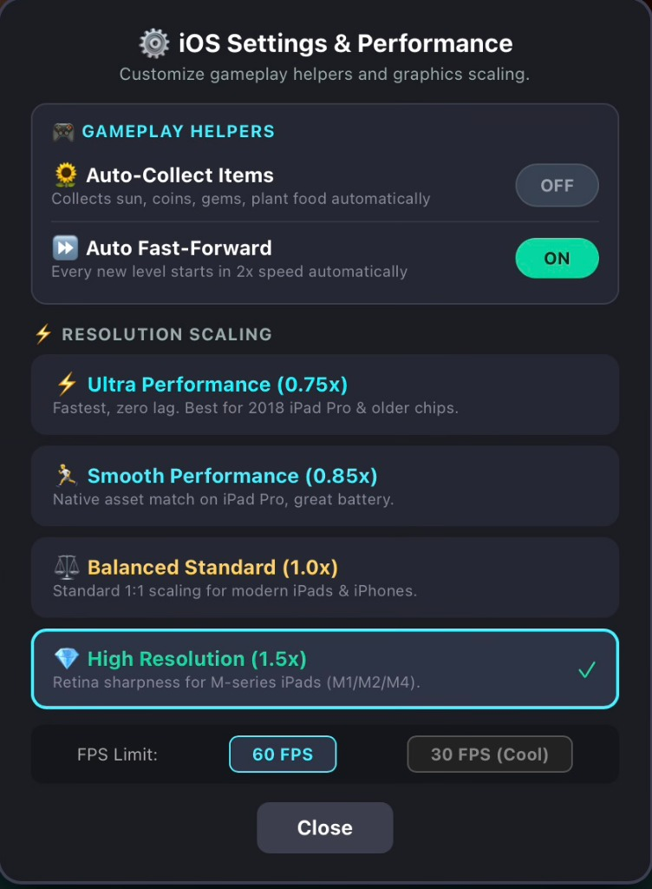

# Plants vs. Zombies 2: Gardendless (iOS Port)

An iOS and iPadOS port of the fan-made PC game **Plants vs. Zombies 2: Gardendless** (v0.16.8), packaged using Capacitor and Cocos Creator.

## Download & Installation

### 📲 AltStore & SideStore Source (One-Click Updates)

You can add this repository as a source in **AltStore** or **SideStore** to install the app and receive automatic update notifications whenever a new version is released:

<p align="left">
  <a href="altstore://source?url=https://raw.githubusercontent.com/Manan2004/PvZ2-Gardendless-iOS/main/apps.json">
    
  </a>
  &nbsp;
  <a href="sidestore://source?url=https://raw.githubusercontent.com/Manan2004/PvZ2-Gardendless-iOS/main/apps.json">
    
  </a>
</p>

**Direct Source URL (Copy & Paste):**
```text
https://raw.githubusercontent.com/Manan2004/PvZ2-Gardendless-iOS/main/apps.json
```

#### How to Add the Source Manually:
1. Open **AltStore** or **SideStore** on your iPhone or iPad.
2. Go to the **Sources** tab and tap the **+** button in the top-right corner.
3. Paste `https://raw.githubusercontent.com/Manan2004/PvZ2-Gardendless-iOS/main/apps.json` and tap **Add**.
4. Navigate to the **Browse** tab, locate **PvZ2 Gardendless**, and tap **FREE** or **UPDATE**!

---

### Manual Sideloading (Direct IPA)

Pre-built IPA files are available on the [Releases](https://github.com/Manan2004/PvZ2-Gardendless-iOS/releases) page.

You can install the IPA using any standard sideloading tool:
- **TrollStore** (recommended if your iOS version supports it): Open `PvZ2_Gardendless.ipa` directly in TrollStore and install.
- **AltStore / SideStore**: Add the downloaded IPA through the **+** button in the My Apps tab.
- **Sideloadly**: Connect your device to your computer, drag the IPA into Sideloadly, and start installation.

## What's New in v0.16.8 (iOS Port)

- **Upstream v0.16.8 Synchronization**:
  - Full parity with PC v0.16.8 upstream release.
  - Added new plants and projectiles (including Aqua Vine, Aqua Vine Plant Food, Kongfu Zomboss Bomb, and Lawn Rift).
  - Synchronized 126 new audio tracks and sound effects with updated sound manifest.
  - Updated 34 asset pack bundles and 10 standalone/cconb game assets.
  - Integrated upstream screenshot utility (`captureScreenshot`).
- **Piñata Party & In-Game Crash Fixes**:
  - Resolved `detectEnemyExtra` null-reference exceptions on Fire Peashooter, Threepeater, Electric Peashooter, and Cold Snapdragon during conveyer-belt levels and Piñata Parties.
  - Added safe bounds and error guards to plant targeting routines.
- **Audio Lifecycle & Backgrounding Fix**:
  - Filtered out WebKit `AbortError` / `NotAllowedError` rejections when swiping out or backgrounding the app.
  - Retained strict background audio pausing to eliminate dual audio playback.
- **Performance & Touch Optimizations**:
  - DragonBones armature batching enabled for projectiles and plant accessories.
  - Uniform caching to prevent GPU stalls when dozens of plants are placed on the lawn.
  - Preserved 30/60/120 FPS ProMotion toggle, Auto-Collect, and Auto Fast-Forward.

## iOS Features & Changes

This port includes several touch-specific quality-of-life adjustments over the original PC version:

- **In-Game Settings Menu**: Tap the gear icon in the bottom-left corner (or 3-finger tap anywhere) to open the settings menu. From here you can toggle:
  - **Auto-Collect**: Automatically collects dropped sun, coins, gems, sprouts, tickets, and plant food (when slots are open). Default is ON.
  - **Auto Fast-Forward**: Automatically starts each level at 2x speed. Default is ON.
  - **Resolution & FPS**: Switch between 30 FPS, 60 FPS, and 120 FPS (for ProMotion screens such as iPad Pro M-series), or adjust rendering scale for older devices. **YOU HAVE TO RESTART THE GAME FOR CHANGES TO APPLY**. 
<p align="center">
  
</p>

- **Tap Sun Bank to Collect All**: Tapping the sun counter at the top-left triggers a full-screen sweep to collect all items (equivalent to pressing the 'A' key on PC). This works even if Auto-Collect is turned off.
- **Touch Controls & Layout**:
  - Fixed touch dragging coordinate bugs on WebKit.
  - Spaced out the fast-forward and shovel buttons so they don't accidentally overlap on smaller screens.
- **Save Import & Export**:
  - Save files are stored directly in the app's Documents folder and can be accessed in the native iOS **Files** app (`On My iPad / iPhone -> PvZ2 Gardendless`).
  - Tapping Export Save in the settings menu opens the native iOS Share Sheet (AirDrop, Save to Files, etc.) with a clipboard copy option.
  - Import works through the standard iOS document picker.
- **Performance**: Paced frame rates for smoother gameplay on older devices (like the 2018 iPad Pro) while supporting up to 120Hz on ProMotion screens.

## Building from Source

### Prerequisites
- macOS with Xcode 15 or later
- Node.js 18+ and npm

### Build Instructions

1. Clone the repo:
   ```bash
   git clone https://github.com/Manan2004/PvZ2-Gardendless-iOS.git
   cd PvZ2-Gardendless-iOS
   ```

2. Install dependencies:
   ```bash
   npm install
   ```

3. Sync web assets to the iOS project:
   ```bash
   npx cap sync ios
   ```

4. Build or run the Xcode project:
   ```bash
   npx cap open ios
   ```
   Or build from the terminal:
   ```bash
   cd ios/App
   xcodebuild -scheme App -configuration Release -destination 'generic/platform=iOS' CODE_SIGNING_ALLOWED=NO CODE_SIGNING_REQUIRED=NO build
   ```

## Credits & Disclaimer

- Original fangame created by Lai Chi / Yu Duo.
- Plants vs. Zombies is a trademark of PopCap Games and Electronic Arts.
- This is a non-commercial fan port made for personal and educational use.
